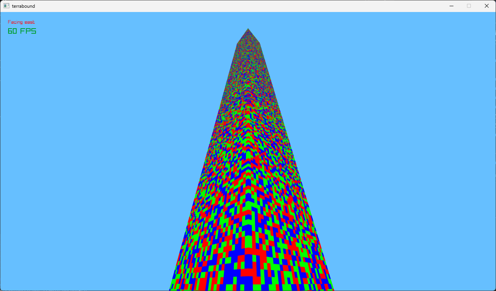
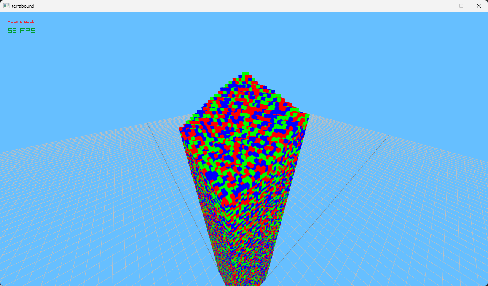
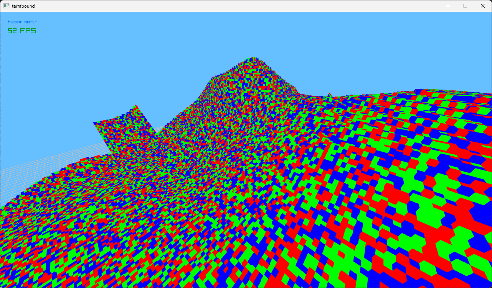
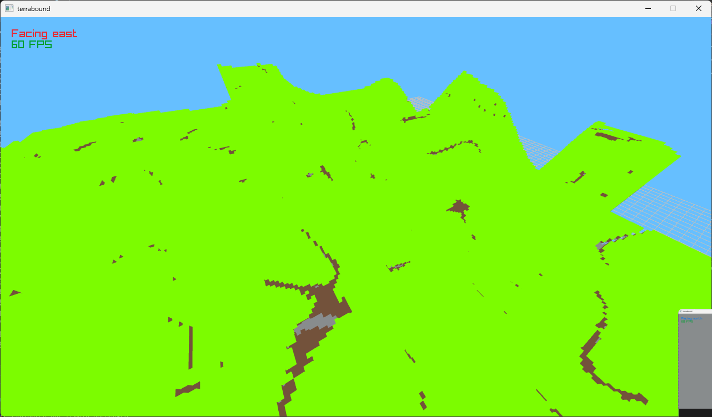
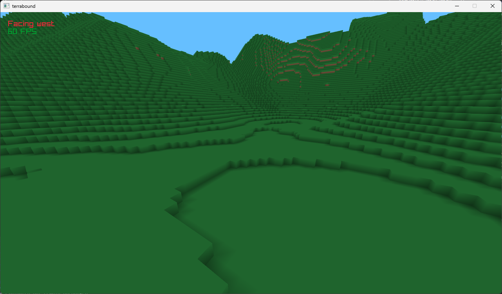

# terrabound Project
## Featuring Adam Bassem and Alex

## Copyright notice and license
Copyright © 2026 Adam Bassem & Alex. All rights reserved. Licensed under Apache 2.0.

## Screenshots

## Extra note
Thanks for taking a moment to check out my project!

If you liked terrabound, don't forget to star the project.
Every star means a lot to me!

-- Adam Bassem and Alex and all contributors.
